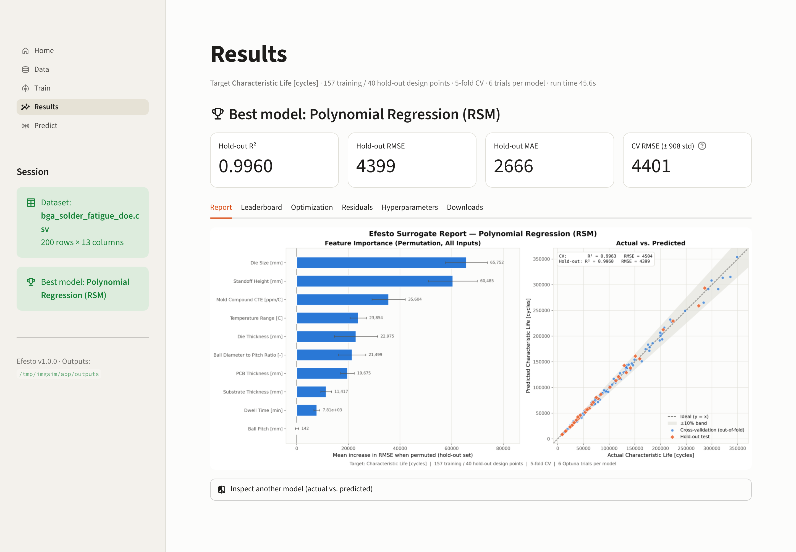
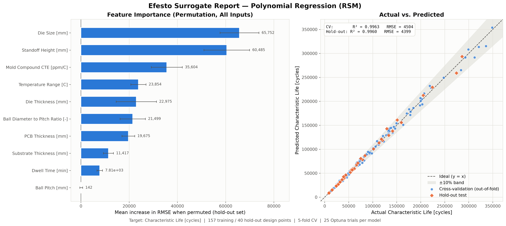

<div align="center">

# 🔥 Hefesto

### Surrogate Model Forge for ANSYS Semiconductor Packaging Simulations

*Turn finite-element design-of-experiments into fast, validated, production-ready regression and classification surrogates.*


</div>

---

## Table of contents

1. [What is Hefesto?](#what-is-hefesto)
2. [Why surrogates for packaging reliability?](#why-surrogates-for-packaging-reliability)
3. [Features](#features)
4. [Quick start (Docker)](#quick-start-docker)
5. [Using the web interface](#using-the-web-interface)
6. [Command-line interface](#command-line-interface)
7. [Preparing ANSYS data](#preparing-ansys-data)
8. [Classification](#classification)
9. [Outlier screening](#outlier-screening)
10. [Available models](#available-models)
11. [Methodology](#methodology)
12. [Outputs](#outputs)
13. [Using a trained model in Python](#using-a-trained-model-in-python)
14. [Project structure](#project-structure)
15. [Local development](#local-development)
16. [Extending Hefesto](#extending-hefesto)
17. [Configuration reference](#configuration-reference)
18. [Troubleshooting](#troubleshooting)
19. [License](#license)

---

## What is Hefesto?

**Hefesto** (Hephaestus, the Greek god of the forge) is a Python application for building
**surrogate models** - also called *metamodels* or *response surfaces*. It was designed primarily
to create surrogates from **semiconductor packaging simulations performed in ANSYS** (Mechanical,
Workbench / DesignXplorer and PyMAPDL), but it works with any tabular dataset. Two tasks are
supported:

- **Regression** - the target is a continuous quantity (warpage, stress, fatigue life...).
- **Classification** - the target is a category, either **binary** (pass / fail, cracked / intact)
  or **multiclass** (failure mode, quality grade, reliability bin).

Given a table of simulated design points (inputs → outputs), Hefesto:

1. **cleans** the ANSYS export (comments, design-point labels, units, failed points),
2. **screens for outliers** and optionally removes them, showing how the distributions change,
3. **benchmarks** the most established regression or classification models in the literature,
4. **tunes** every model with **Bayesian hyperparameter optimization** (Optuna) under
   **K-fold cross-validation** (stratified by class for classification),
5. **selects** the best model by the chosen metric and validates it on an **untouched hold-out set**,
6. **exports** the best model as a **`.joblib`** file together with a report figure showing
   **feature importance** next to **actual vs. predicted** values (regression) or the **confusion
   matrix** (classification), plus all metrics and tables.

Everything runs in **Docker**, so the same environment works on a laptop, a workstation or a server
with a single command. The graphical interface is built with **Streamlit**; a CLI is available for
batch and CI use.

## Why surrogates for packaging reliability?

A single thermo-mechanical FEA of a BGA, flip-chip or fan-out package - with viscoplastic solder
(Anand / Garofalo), temperature-dependent EMC and substrate properties and thermal cycling - can take
minutes to hours. Design exploration, sensitivity studies, robust design and optimization need
thousands of evaluations. A well-validated surrogate answers in milliseconds.

Typical responses modeled with Hefesto:

| Application | Typical response (target) |
|---|---|
| Solder-joint thermal fatigue (BGA / CSP / SMT) | Plastic work density ΔW, Darveaux characteristic life, creep strain |
| Package / strip warpage | Max out-of-plane deformation at reflow or room temperature |
| Interface delamination (EMC-substrate, die-attach) | Energy release rate, peel / shear stress |
| Die cracking, dicing, microcracks | Max principal stress, crack margin |
| Underfill / molding | Void formation index, flow front metrics |
| Thermal | Junction temperature, thermal resistance |
| Pass / fail screening (classification) | Does the design meet the cycle-life or warpage spec? |
| Failure-mode prediction (classification) | Solder crack, pad cratering, delamination, die crack |
| Reliability grading (classification) | Life bin or quality grade (A / B / C) |

## Features

- **18 regression models** - linear, polynomial response surface (RSM), Gaussian process (Kriging),
  SVR, KNN, decision tree, Random Forest, Extra Trees, Gradient Boosting, Histogram Gradient Boosting,
  AdaBoost, **XGBoost**, **LightGBM**, **MLP** neural network, and optional CatBoost.
- **Binary and multiclass classification** (pass/fail, failure mode, quality grade...) with
  **Logistic Regression** (binary), **Random Forest**, **XGBoost** and **MLP**, tuned with the same
  Optuna protocol, **stratified** folds and hold-out, the same input normalization and the same
  outlier screening. Labels can be text or integers; predictions return the original labels and
  per-class probabilities.
- **Outlier screening** before training (IQR or robust z-score), with optional removal and an
  original-vs-cleaned distribution comparison.
- **Cross-validation**: K-fold or repeated K-fold (stratified for classification), with **identical
  folds for every model** (paired, fair comparison).
- **Hyperparameter optimization** with **Optuna TPE** and **fold-level median pruning**; search spaces
  sized for simulation datasets (tens to thousands of design points).
- **Untouched hold-out test**, optionally **stratified** on target quantiles (regression) or on the
  classes (classification) so the full response range / every class is tested.
- **Log-target option** for responses spanning orders of magnitude (fatigue life in cycles).
- **Automatic target standardization** so scale-dependent hyperparameters behave the same whether
  the response is in µm or in millions of cycles.
- **Feature importance**: model-agnostic **permutation importance** (with uncertainty) or native
  importance (trees / linear coefficients).
- **Report figure** (PNG 300 dpi + vector PDF): **feature importance** side by side with **actual
  vs. predicted** (regression) or the **confusion matrix** (classification). The PDF adds a
  **metrics table** page, and each panel is also saved as its own PNG.
- **ANSYS-aware data loader** and **target-leakage warning** (inputs almost perfectly correlated with
  the target).
- **Self-describing `.joblib`**: a plain scikit-learn pipeline (preprocessing + model + target
  transform) carrying its own metadata, including the **training domain**.
- **Prediction page / CLI** with **extrapolation warnings** for inputs outside the training domain.
- **Reproducible**: global seed, pinned dependencies, `config.json` and `model_card.json` per run.
- **Production practices**: typed configuration with validation, structured logging, non-root Docker
  image with health check, test suite, linting.

## Quick start (Docker)

**Requirements:** [Docker](https://docs.docker.com/get-docker/) with Docker Compose v2.

```bash
# 1. Get the code
cd hefesto

# 2. Build and start
docker compose up -d --build

# 3. Open the interface
#    http://localhost:8501
```

Trained models and reports are written to `./outputs` on your machine (mounted volume). Put your
ANSYS exports in `./data` if you want them reachable from the CLI container.

Other useful commands (or use the `Makefile`: `make build`, `make up`, `make down`, `make logs`):

```bash
docker compose logs -f hefesto        # follow logs
docker compose down                  # stop
HEFESTO_PORT=8600 docker compose up -d  # use another port
```

Without Compose:

```bash
docker build -t hefesto:1.0.0 .
docker run -d -p 8501:8501 -v "$PWD/outputs:/app/outputs" --name hefesto hefesto:1.0.0
```

Optional extras (e.g. CatBoost):

```bash
HEFESTO_EXTRA_PACKAGES="catboost" docker compose build
```

> **Linux bind-mount permissions:** the container runs as a non-root user (UID/GID 1000 by
> default). If your user has a different UID, build with `UID=$(id -u) GID=$(id -g) docker compose build`.

## Using the web interface



The interface has five pages (left sidebar):

| Page | What you do there |
|---|---|
| **Home** | Overview of the workflow. |
| **Data** | Upload CSV / TXT / Excel / Parquet, or load the **demo dataset** (synthetic BGA fatigue DOE). See the cleaning report, statistics, correlation heatmap and distributions. **Outlier check** (IQR or robust z-score) before training, with optional removal and an original-vs-cleaned distribution comparison. |
| **Train** | Choose the **task** (regression or classification - suggested from the target), the **target**, the **input features** and the **models**; configure folds, repetitions, hold-out fraction, number of Optuna trials, metric, log target (regression), importance method. For classification the class counts are shown, with a hint when classes are imbalanced. Click **Forge surrogates** and follow the live progress. |
| **Results** | Best model KPIs (R² / RMSE / MAE or accuracy / F1 / ROC AUC), the **report figure**, the **leaderboard** (all models, CV and hold-out metrics), the **optimization history** per model, **residuals** (regression) or **classes** (interactive confusion matrix + per-class precision / recall / F1), tuned **hyperparameters**, and **downloads** (`.joblib`, PNGs, PDF, CSVs, full run `.zip`). |
| **Predict** | Load a model (current session, a saved run or an uploaded `.joblib`) and predict a **single design point** or a **batch file**, with out-of-domain flags. Classifiers return the predicted class and the probability of every class. |

## Command-line interface

The same engine is available headless, useful on servers, in CI or after an overnight ANSYS run.

```bash
# List models
docker compose run --rm hefesto-cli list-models

# Train (paths are inside the container: ./data -> /app/data, ./outputs -> /app/outputs)
docker compose run --rm hefesto-cli train \
  --data /app/data/my_doe.csv \
  --target "Characteristic Life [cycles]" \
  --exclude "Plastic Work Density [MPa]" "Max Package Warpage [um]" \
  --models polynomial gpr svr xgboost lightgbm mlp \
  --trials 60 --folds 5 --repeats 2 --test-size 0.2 \
  --metric rmse --log-target \
  --remove-outliers iqr          # optional: drop outlier rows (target + inputs) first

# Every available model
docker compose run --rm hefesto-cli train --data /app/data/my_doe.csv --target "Warpage [um]" --models all

# Classification (binary or multiclass)
docker compose run --rm hefesto-cli train \
  --data /app/data/my_doe.csv \
  --target "Failure Mode" \
  --task classification \
  --models logistic random_forest xgboost mlp \
  --metric f1_macro --trials 40 --folds 5 \
  --remove-outliers zscore       # optional: screens the inputs only

# Predict new designs
docker compose run --rm hefesto-cli predict \
  --model /app/outputs/<run>/best_model.joblib \
  --data /app/data/new_designs.csv --output /app/outputs/new_predictions.csv
```

Run `hefesto train --help` for every option. When `--features` is omitted, all numeric columns except
the target and `--exclude` are used. `--task auto` (default) picks classification for text, boolean
or integer targets with at most 10 distinct values, and regression otherwise. Without `--models`,
the task's default selection is used; `--metric` defaults to `rmse` (regression) or `f1_macro`
(classification).

## Preparing ANSYS data

Hefesto expects **one row per design point** and **one column per parameter**. It accepts:

- **ANSYS Workbench / DesignXplorer** parameter tables exported to CSV (Design Points, DOE or
  Response Surface tables). Handled automatically:
  - `#` comment / header lines,
  - the `Name` column with `DP 0`, `DP 1`, ... labels (dropped as an identifier),
  - `P# - ` prefixes in headers (optionally simplified: `P3 - Total Deformation [mm]` →
    `Total Deformation [mm]`),
  - units in brackets in the header or in a separate units row,
  - failed design points (`Update failed`, empty cells, `N/A`) → treated as missing,
  - any delimiter (`,` `;` tab `|`) and decimal commas.
- **PyMAPDL / custom DOE scripts** writing plain CSV.
- **Excel** (`.xlsx`, `.xls`) and **Parquet**.

Recommendations:

- Keep only **design inputs** as features. Other outputs of the same simulation (e.g. ΔW when the
  target is life) leak information; Hefesto warns when an input is almost perfectly correlated with the
  target.
- Prefer **space-filling designs** (Latin Hypercube, Sobol, optimal space-filling) over full
  factorials for training surrogates.
- As a rule of thumb, aim for **at least 10 design points per input** for non-linear responses.
- Use the **log target** for fatigue life and any strictly positive response spanning orders of
  magnitude.
- For classification, store the label in **one column** (e.g. `Failure Mode` = `solder_crack` /
  `delamination` / `none`, or `Pass` = `0` / `1`). Labels may be text, booleans or integers;
  integer labels read back as `1.0`, `2.0`... are restored to `1`, `2`...

## Classification

Hefesto trains **binary** and **multiclass** classifiers with the same workflow as the regression
surrogates: the same input preprocessing (median imputation + standardization for numeric inputs,
most-frequent imputation + one-hot encoding for categorical inputs), the same Optuna tuning with
pruning, the same outlier screening and the same artifacts.

**Choosing the task.** In the UI, pick *Regression* or *Classification* on the Train page (the
task is suggested from the target column). With the CLI, use `--task classification`, or leave the
default `--task auto`, which selects classification for text, boolean or integer targets with at
most 10 distinct values.

**Requirements on the target.**

| Rule | Why |
|---|---|
| At least 2 classes, at most 50 | One class has nothing to learn; many classes usually means a continuous response |
| Every class has at least 2 rows | Needed for stratified splits |
| Number of CV folds ≤ rows of the smallest class | Folds are reduced automatically when a class is rare |

**Models.** Logistic Regression (**binary targets only** - it is hidden from the model list and
rejected by the trainer for multiclass targets), Random Forest, XGBoost and MLP. Default selection:
all four (three for multiclass). See [Classification models](#classification-models).

**Validation.** Cross-validation uses `RepeatedStratifiedKFold` and the hold-out split is stratified
on the classes, so every class appears in every fold and in the test set.

**Metrics.**

| Key | Metric | Direction | Notes |
|---|---|---|---|
| `accuracy` | Accuracy | ↑ | Misleading on imbalanced classes |
| `balanced_accuracy` | Balanced accuracy | ↑ | Mean recall per class |
| `f1_macro` | F1 (macro) | ↑ | **Default**; every class weighs the same |
| `precision_macro` | Precision (macro) | ↑ | |
| `recall_macro` | Recall (macro) | ↑ | |
| `roc_auc` | ROC AUC | ↑ | Binary: probability of the second class; multiclass: one-vs-rest macro |
| `log_loss` | Log loss | ↓ | Rewards well-calibrated probabilities |

All metrics are reported for every model (CV mean ± std, out-of-fold, hold-out); the selected one
drives the tuning and ranking.

**Class imbalance.** The Train page shows the class counts and flags imbalanced classes. Prefer
`f1_macro`, `balanced_accuracy` or `roc_auc` over accuracy in that case; Logistic Regression and
Random Forest also tune class weighting (`balanced`, and `balanced_subsample` for the forest).

**Report and results.** The actual-vs-predicted panel is replaced by a **confusion matrix**
(counts and row percentages, hold-out or CV out-of-fold), saved in the report figure and as
`confusion_matrix.png`. The Results page adds a **Classes** tab with an interactive confusion matrix
and per-class precision, recall and F1.

**Predictions.** The saved `.joblib` predicts the **original labels** (text or integers) and exposes
`predict_proba`, with columns ordered as `model.classes_`. `predictions.csv` and the Predict page
include a `proba_<class>` column per class.

## Outlier screening

The **Data** page checks the dataset for outliers **before training**:

| Method | Rule | Default threshold |
|---|---|---|
| IQR (Tukey fences) | value < Q1 − k·IQR or > Q3 + k·IQR | k = 1.5 |
| Robust z-score | \|x − median\| / (1.4826·MAD) > k | k = 3.5 |

- A row is flagged when **any** screened column is outside its bounds; missing values are never
  flagged. Columns with zero spread (IQR or MAD = 0) are not screened.
- The flagged rows and the bounds per column are shown, and they can be **removed**, re-screened
  with other settings or **restored**.
- The **Distributions** tab overlays the original and cleaned distributions with the bounds and a
  statistics table (count, mean, std, min, median, max, skewness, kurtosis) with the change in %.
- For regression the target and the inputs are screened; for **classification only the inputs** are
  screened, because a rare class is not an outlier.
- The settings used are recorded in `model_card.json` (`data_preprocessing`). In the CLI use
  `--remove-outliers iqr|zscore` and optionally `--outlier-threshold`.

## Available models

### Regression models

| Key | Model | Family | Notes |
|---|---|---|---|
| `linear` | Linear Regression | Linear | Baseline, no hyperparameters |
| `ridge` | Ridge Regression | Linear | L2 penalty |
| `lasso` | Lasso Regression | Linear | L1 penalty, implicit selection |
| `elasticnet` | Elastic Net | Linear | L1 + L2 |
| `polynomial` | Polynomial Regression (RSM) | Linear | 2nd/3rd-order response surface + ridge - classic DOE surrogate |
| `knn` | K-Nearest Neighbors | Instance-based | Distance-weighted interpolation |
| `svr` | Support Vector Regression | Kernel | RBF / polynomial kernels |
| `gpr` | Gaussian Process (Kriging) | Kernel | RBF, Matérn 3/2, Matérn 5/2, Rational Quadratic + noise; best for small, smooth DOEs |
| `decision_tree` | Decision Tree | Tree | Interpretable, high variance |
| `random_forest` | Random Forest | Tree ensemble | Robust default |
| `extra_trees` | Extra Trees | Tree ensemble | Smoother on continuous inputs |
| `gradient_boosting` | Gradient Boosting | Boosting | scikit-learn GBM |
| `hist_gradient_boosting` | Histogram Gradient Boosting | Boosting | Fast, larger datasets |
| `adaboost` | AdaBoost | Boosting | Boosted shallow trees |
| `xgboost` | XGBoost | Boosting | Regularized boosting |
| `lightgbm` | LightGBM | Boosting | Leaf-wise boosting |
| `catboost` | CatBoost | Boosting | Optional (`pip install catboost`) |
| `mlp` | Multilayer Perceptron | Neural network | Tuned depth (1-3 layers), width, activation, L2, solver (L-BFGS / Adam) |

Default selection: polynomial RSM, Gaussian process, Random Forest, XGBoost and MLP.

### Classification models

| Key | Model | Family | Tuned hyperparameters |
|---|---|---|---|
| `logistic` | Logistic Regression | Linear | Penalty (L2 / L1 / elastic-net), `C`, class weighting. **Binary targets only** |
| `random_forest` | Random Forest | Tree ensemble | Trees, depth, leaf sizes, features per split, bootstrap, criterion (Gini / entropy), class weighting |
| `xgboost` | XGBoost | Boosting | Trees, learning rate, depth, child weight, subsampling, gamma, L1/L2 |
| `mlp` | Multilayer Perceptron | Neural network | Depth (1-3 layers), width, activation, L2, solver (L-BFGS / Adam) |

Default selection: all four for binary targets; Random Forest, XGBoost and MLP for multiclass.
`hefesto list-models` prints both tables.

## Methodology

```
             ┌──────────────── full dataset (rows with a valid target) ────────────────┐
             │                                                                          │
   stratified│ split on target quantiles (regression) or classes (classification)      │
             ▼                                                                          ▼
     ┌──────────────────────────┐                                         ┌─────────────────────┐
     │     training set (80%)   │                                         │  hold-out set (20%) │
     └──────────────────────────┘                                         │  never used for     │
         │  same K-fold splits for every model and trial                  │  tuning or ranking* │
         ▼                                                                └─────────────────────┘
   for each model:                                                                   ▲
     Optuna TPE study  ──►  trial = hyperparameters ──► K-fold CV score               │
                            (median pruner stops bad trials fold by fold)             │
     best trial ──► re-evaluated: fold scores + out-of-fold predictions               │
               ──► refit on the full training set ──────────────────────────► scored ─┘
   rank models by mean CV score ──► best model ──► permutation importance on hold-out
```

\* unless you explicitly choose *Select the best model by: hold-out score*.

Details that matter:

- **Regression pipeline**: `TransformedTargetRegressor( Pipeline[ ColumnTransformer(impute → scale |
  impute → one-hot), model ], target = [log] → standardize )`.
- **Classification pipeline**: `LabelEncodedClassifier( Pipeline[ ColumnTransformer(impute → scale |
  impute → one-hot), model ] )` - labels are encoded to `0..K-1` for training (required by XGBoost)
  and decoded back on `predict`.
- Preprocessing is fitted **inside each fold**, so there is no leakage from validation data.
- **Regression metrics** (R², RMSE, MAE, MAPE, max error) are always computed in **original target
  units**. **Classification metrics** use the predicted labels, and the class probabilities for ROC
  AUC and log loss.
- **Cross-validation** is `RepeatedKFold` for regression and `RepeatedStratifiedKFold` for
  classification.
- **CV score** = mean of fold scores (± std). The leaderboard also reports metrics on the pooled
  out-of-fold predictions.
- **Permutation importance** = mean degradation of the selected metric when a column is shuffled on
  the hold-out set (15 repeats by default), reported with its standard deviation.
- Every random component (splits, sampler, estimators) uses the configured **seed**.

## Outputs

Each run creates `outputs/<YYYYmmdd-HHMMSS>_<target>/`:

| File | Content |
|---|---|
| `best_model.joblib` | Best fitted pipeline (preprocessing + model + target transform / label encoding) with embedded metadata |
| `surrogate_report.png` / `.pdf` | **Feature importance** (left) and **actual vs. predicted** or **confusion matrix** (right), titled, 300 dpi / vector. The PDF has a second page with the **metrics table** of every model (CV and hold-out) |
| `feature_importance.png` | Importance panel as its own 300 dpi image, with only its own title |
| `actual_vs_predicted.png` | Regression: actual vs. predicted panel as its own image |
| `confusion_matrix.png` | Classification: confusion matrix panel as its own image |
| `model_card.json` | Task, target, classes, features, training domain, outlier removal, hyperparameters, CV / train / hold-out metrics, library versions |
| `leaderboard.csv` | All models ranked, with CV and hold-out metrics, trial counts and timing |
| `feature_importance.csv` | Importance per input (mean, std, relative %) |
| `predictions.csv` | Inputs, actual and predicted values for out-of-fold and hold-out points, plus `residual` (regression) or `correct` and `proba_<class>` columns (classification) |
| `optuna_trials/<model>.csv` | Full optimization history per model |
| `config.json` | Exact configuration to reproduce the run |
| `models/<model>.joblib` | Every tuned model (only with *Save every tuned model*) |

Example report (synthetic BGA fatigue demo, target = characteristic life, log target):



## Using a trained model in Python

```python
import joblib
import pandas as pd

model = joblib.load("outputs/<run>/best_model.joblib")
meta = model.hefesto_metadata_                  # model card embedded in the object

X_new = pd.read_csv("new_designs.csv")[meta["features"]]
y_pred = model.predict(X_new)                  # already in the original target units
```

For a classifier, `predict` returns the original labels and `predict_proba` the class
probabilities:

```python
labels = model.predict(X_new)                  # e.g. "pass" / "fail"
proba = model.predict_proba(X_new)             # one column per class, ordered as model.classes_
print(model.classes_, meta["task"])            # ['fail' 'pass'] classification
```

The object is a standard scikit-learn estimator: it only needs `scikit-learn` (plus `xgboost` /
`lightgbm` if those won) in compatible versions - see `library_versions` in the model card. With
Hefesto installed you also get the extrapolation check:

```python
from hefesto.inference import load_model, predict

surrogate = load_model("outputs/<run>/best_model.joblib")
result = predict(surrogate, pd.read_csv("new_designs.csv"))   # adds out_of_domain (and proba_*) columns
```

> ⚠️ `joblib` / pickle files can execute code when loaded. Only load models you trust.

## Project structure

```
hefesto/
├── app/                         # Streamlit interface
│   ├── streamlit_app.py         #   entry point and navigation
│   ├── ui_common.py             #   styling, session state, chart theme
│   └── views/                   #   Home, Data, Train, Results, Predict pages
├── src/hefesto/                  # Core library (UI-independent)
│   ├── config.py                #   TrainingConfig (typed + validated)
│   ├── data.py                  #   ANSYS-aware loading, cleaning, task / class detection
│   ├── outliers.py              #   IQR / robust z-score outlier screening
│   ├── models.py                #   regression + classification registries, search spaces, pipelines
│   ├── training.py              #   (stratified) CV + Optuna tuning + model selection
│   ├── metrics.py               #   regression / classification metrics with optimization direction
│   ├── importance.py            #   permutation / native feature importance
│   ├── plotting.py              #   report figure, confusion matrix, metrics table
│   ├── artifacts.py             #   joblib, figures, model card, CSVs, zip
│   ├── inference.py             #   loading models, prediction, domain checks
│   ├── samples.py               #   synthetic demo dataset
│   └── cli.py                   #   command-line interface
├── examples/                    # demo dataset + generator
├── tests/                       # pytest suite
├── .streamlit/config.toml       # UI theme and server settings
├── Dockerfile                   # multi-stage, non-root, health-checked image
├── docker-compose.yml           # web service + CLI profile
├── Makefile
├── pyproject.toml               # package metadata, tool configuration
├── requirements.txt             # pinned runtime dependencies (Docker)
└── requirements-dev.txt
```

## Local development

```bash
python -m venv .venv && source .venv/bin/activate      # Windows: .venv\Scripts\activate
pip install -r requirements-dev.txt
pip install -e ".[ui,dev]"

streamlit run app/streamlit_app.py     # UI at http://localhost:8501
python -m pytest                       # tests
ruff check src app tests               # lint
```

Tests inside Docker: `make docker-test`.

## Extending Hefesto

Add a model by registering one `ModelSpec` in `src/hefesto/models.py` (pass `task="classification"`,
and `binary_only=True` if relevant, for a classifier):

```python
from sklearn.linear_model import HuberRegressor

def _space_huber(trial, ctx):
    return {"epsilon": trial.suggest_float("epsilon", 1.1, 2.5),
            "alpha": trial.suggest_float("alpha", 1e-6, 1e-1, log=True)}

register(ModelSpec("huber", "Huber Regression", "Linear",
                   "Linear model robust to outliers.",
                   _simple(HuberRegressor, max_iter=2000), _space_huber))
```

The trainer, UI, CLI and tests pick it up automatically.

## Configuration reference

Environment variables:

| Variable | Default | Description |
|---|---|---|
| `HEFESTO_OUTPUT_DIR` | `outputs` (`/app/outputs` in Docker) | Where runs are saved |
| `HEFESTO_EXAMPLES_DIR` | `examples` | Location of the demo dataset |
| `HEFESTO_LOG_LEVEL` | `INFO` | `DEBUG`, `INFO`, `WARNING`, `ERROR` |
| `HEFESTO_PORT` | `8501` | Host port (Compose) |
| `HEFESTO_EXTRA_PACKAGES` | *(empty)* | Extra pip packages at build time (Compose) |

Main training options (UI and `TrainingConfig`):

| Option | Default | Meaning |
|---|---|---|
| `cv_folds` / `cv_repeats` | 5 / 1 | K-fold CV; repeats > 1 → repeated K-fold |
| `test_size` | 0.2 | Hold-out fraction (0 = CV only) |
| `n_trials` | 30 | Optuna trials per model |
| `task` | `regression` | `regression` or `classification` (binary / multiclass) |
| `metric` | `rmse` / `f1_macro` | Regression: `rmse`, `mae`, `r2`, `mape`, `max_error`. Classification: `accuracy`, `balanced_accuracy`, `f1_macro`, `precision_macro`, `recall_macro`, `roc_auc`, `log_loss` |
| `selection_basis` | `cv` | Rank by mean CV score or hold-out score |
| `log_target` | off | Fit on log(y) (regression only) |
| `stratify_split` | on | Stratify hold-out on target quantiles (regression) or classes (classification) |
| `importance_method` | `permutation` | or `native` |
| `timeout_per_model` | none | Wall-clock budget per model (s) |
| `random_state` | 42 | Global seed |

## Troubleshooting

| Symptom | Fix |
|---|---|
| Port 8501 already in use | `HEFESTO_PORT=8600 docker compose up -d` |
| `Permission denied` writing `outputs/` | Rebuild with your UID/GID (see Quick start) |
| A model is marked *failed* | Check the leaderboard *Status* column and container logs; other models still run |
| Gaussian process is slow | GP scales as O(n³); prefer it below ~3 000 design points |
| *Log transform requires a strictly positive target* | Disable the log target or model a shifted response |
| *Possible target leakage* warning | Remove other simulation outputs from the input list |
| Very low R² on all models | Check units / failed points in the Data page; increase design points or trials |
| *Every class needs at least 2 rows* | Remove or merge the rare classes |
| *supports binary targets only* | Logistic Regression was selected for a multiclass target; use the other classifiers |
| *not a classification metric* | Pick a metric of the selected task (e.g. `f1_macro`, not `rmse`) |
| High accuracy but poor F1 / balanced accuracy | Classes are imbalanced; rank by `f1_macro` or `balanced_accuracy` |
| Integer target treated as regression | Select *Classification* on the Train page or pass `--task classification` |

## License

MIT. The demo dataset is synthetic (closed-form approximations on a Latin Hypercube design) and is
intended for demonstration only - it is not simulation data and must not be used for engineering
decisions.
